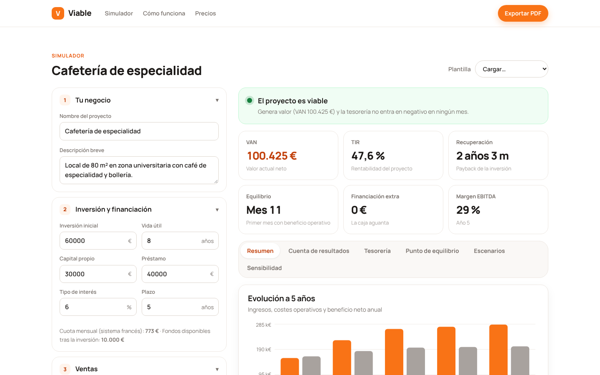
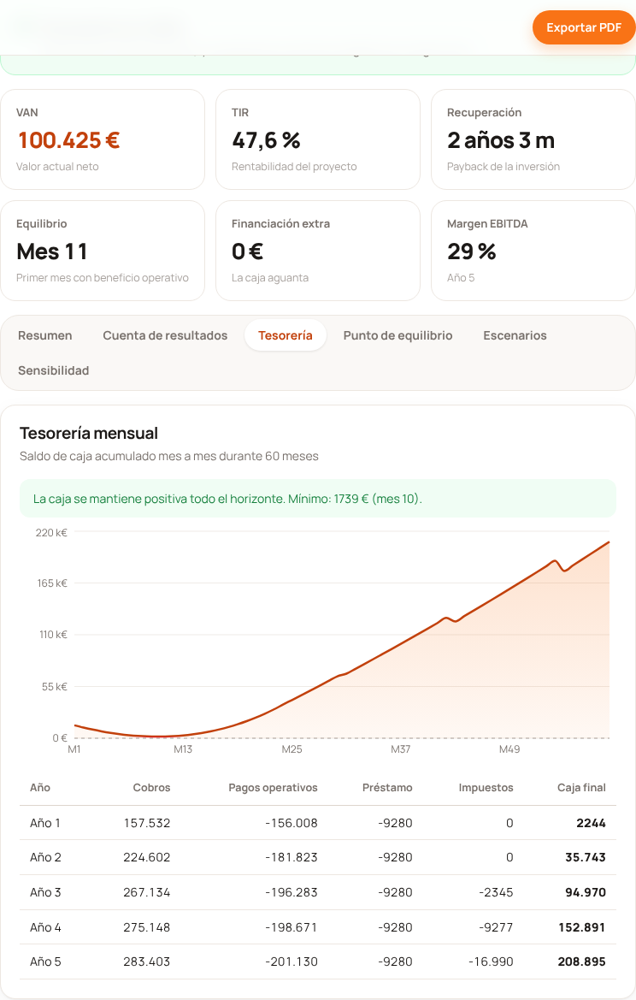
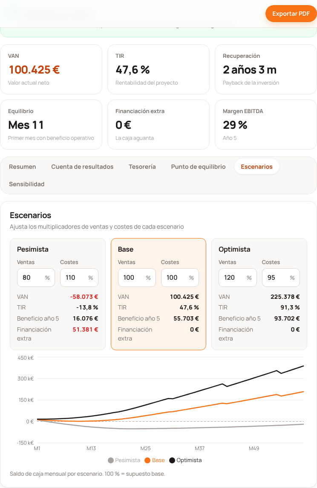
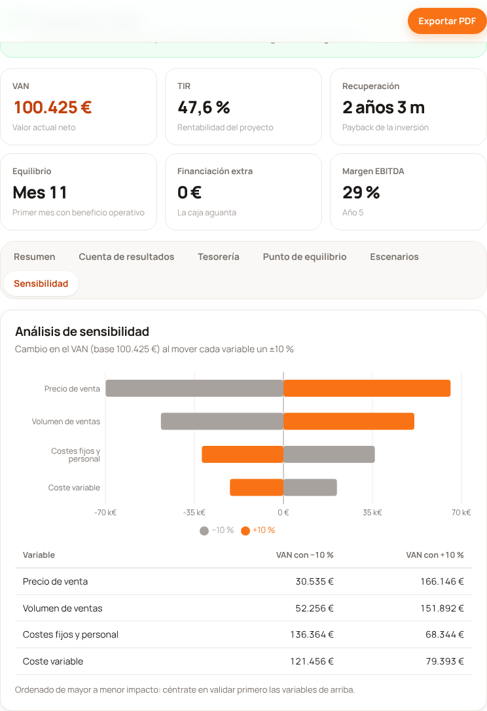

# Viable · Simulador de planes de viabilidad

> Crea el plan de viabilidad de un negocio en minutos: cuenta de resultados a 5 años, tesorería mes a mes, punto de equilibrio, VAN, TIR, escenarios y sensibilidad. Todo en el navegador.



## El problema

Quien quiere montar un negocio en España necesita un **plan de viabilidad** para pedir un préstamo al banco, una línea ENISA, una ayuda pública o convencer a un socio. Hoy hay tres opciones y ninguna es buena:

| Opción | Problema |
|---|---|
| Plantilla de Excel | Fórmulas frágiles, sin tesorería real ni impuestos bien modelados, y una barrera técnica para quien no es financiero. |
| Consultor o asesoría | Entre 300 y 1.500 € por plan, y días de espera para cada cambio de supuestos. |
| Hacerlo «a ojo» | Los errores típicos (olvidar la Seguridad Social, el IVA, los plazos de cobro o el Impuesto de Sociedades) aparecen cuando ya no hay caja. |

## La solución

Viable convierte unos pocos supuestos en un plan financiero completo que se recalcula al instante:

- **Cuenta de resultados previsional a 5 años**: de los ingresos al resultado neto, pasando por EBITDA, amortizaciones, gastos financieros e Impuesto de Sociedades.
- **Tesorería mensual (60 meses)** con plazos de cobro y pago, cuota del préstamo e impuestos. Avisa de los meses con caja negativa y calcula la **necesidad máxima de financiación**.
- **Punto de equilibrio** en ventas y unidades mensuales, y el mes en que se alcanza.
- **VAN, TIR y plazo de recuperación** sobre el flujo de caja libre, con valor residual opcional.
- **Escenarios** pesimista, base y optimista con multiplicadores de ventas y costes editables.
- **Análisis de sensibilidad** (gráfico de tornado) para ver qué variable decide el proyecto.
- **Informe en PDF** con portada, supuestos y todos los análisis.
- **Plantillas de ejemplo**: cafetería, SaaS B2B y tienda online.

| Tesorería | Escenarios | Sensibilidad |
|---|---|---|
|  |  |  |

Hay un informe PDF de ejemplo en [`docs/screenshots/informe-ejemplo.pdf`](docs/screenshots/informe-ejemplo.pdf).

## Cómo ejecutarlo

```bash
npm install
npm run dev       # servidor de desarrollo en http://localhost:5173
npm test          # tests del motor financiero
npm run build     # build de producción en dist/ (estático, desplegable en Vercel, Netlify o GitHub Pages)
```

## Decisiones técnicas

- **Vite + React + TypeScript, sin backend.** Los datos de un plan de negocio son sensibles; procesarlos en el navegador elimina costes de servidor y es un argumento de venta: *tus datos no salen de tu dispositivo*. El plan se guarda en `localStorage`, con tolerancia a fallos si no está disponible.
- **Motor financiero puro y testeado** (`src/engine`). Toda la lógica está separada de la interfaz en funciones sin efectos secundarios, cubiertas con Vitest:
  - `npv`, `irr` (bisección robusta, devuelve `null` si no hay cambio de signo), `loanPayment` y `loanSchedule` (sistema francés).
  - `corporateTax`: compensación de bases imponibles negativas y tipo reducido del 15 % para entidades de nueva creación en el primer ejercicio con base positiva y el siguiente (art. 29.1 LIS).
  - `simulate`: proyección mensual a 60 meses que agrega a años, y `sensitivity`, que mueve cada variable ±10 %.
- **Separación de resultado y caja.** La cuenta de resultados es de devengo; la tesorería desplaza cobros y pagos según los días medios, paga el Impuesto de Sociedades en julio del ejercicio siguiente e incluye la cuota completa del préstamo. El VAN se calcula sobre el **flujo de caja libre sin financiación** (EBITDA − impuesto sobre el EBIT − variación del circulante), como en la valoración de proyectos.
- **Recharts** para los gráficos y **CSS propio** con variables de diseño, en lugar de un framework de componentes.
- **PDF con la impresión del navegador** y una hoja de estilos `@media print` cuidada. Es más fiable que rasterizar con html2canvas: el texto sigue siendo seleccionable y el archivo pesa poco.

### Simplificaciones conocidas

- Importes sin IVA: el IVA repercutido y el soportado se compensan y no afectan al resultado. No se modela el desfase trimestral de las liquidaciones.
- Amortización lineal, sin pagos fraccionados del Impuesto de Sociedades ni límite del 70 % en la compensación de bases (solo aplica por encima de 1 M€).
- El crecimiento mensual de unidades se aplica los dos primeros años; después se usa una tasa anual para evitar proyecciones explosivas.

## Modelo de negocio

| Plan | Precio | Para quién |
|---|---|---|
| **Gratis** | 0 € | Simular sin límite. Es el canal de adquisición: el usuario ve el valor antes de pagar. |
| **Informe profesional** | 39 € por plan exportado | El emprendedor que tiene que presentar el plan al banco, a ENISA o a sus socios. Se paga en el momento de máxima necesidad. |
| **Instituciones** | 1.490 €/año | Incubadoras, aceleradoras, universidades y cámaras de comercio que acompañan a decenas de emprendedores. Marca blanca y panel de seguimiento. |

**Por qué funciona:**
- **Precio anclado al consultor**: 39 € frente a los 300–1.500 € de la alternativa.
- **Coste marginal casi nulo**: sin servidor de cálculo, el margen bruto se acerca al 100 %.
- **El canal B2B2C reduce el coste de adquisición**: una incubadora con 100 emprendedores al año equivale a 38 informes sueltos y además da recurrencia.
- **Unit economics orientativos**: si el CAC por SEO y contenido es de unos 15 € y el 8 % de los usuarios gratuitos compra un informe, cada 100 usuarios generan 312 € con un coste de 1.500 € de adquisición. Por eso el canal institucional es prioritario.

## Roadmap

1. Pagos reales con Stripe Checkout y PDF sin marca de agua.
2. Cuentas de usuario y varios planes guardados en la nube (cifrados).
3. IVA trimestral en tesorería, pagos fraccionados y balance de situación previsional.
4. Panel para instituciones: seguimiento de los planes de sus emprendedores.
5. Asistente con IA que propone supuestos sectoriales y revisa la coherencia del plan.
6. Exportación a Excel para asesores.

## Estructura

```
src/
  engine/        Motor financiero puro (tipos, finanzas, simulación, plantillas y tests)
  components/    Landing y precios, formulario de supuestos, resultados y gráficos
  App.tsx        Estado, persistencia, exportación a PDF
  styles.css     Sistema visual (blanco con acentos naranjas) y estilos de impresión
docs/screenshots Capturas de escritorio y móvil, e informe PDF de ejemplo
```
